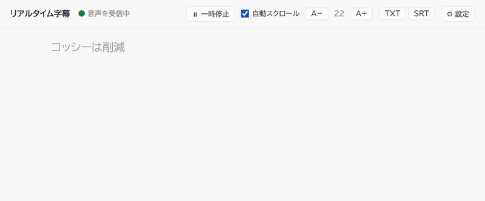
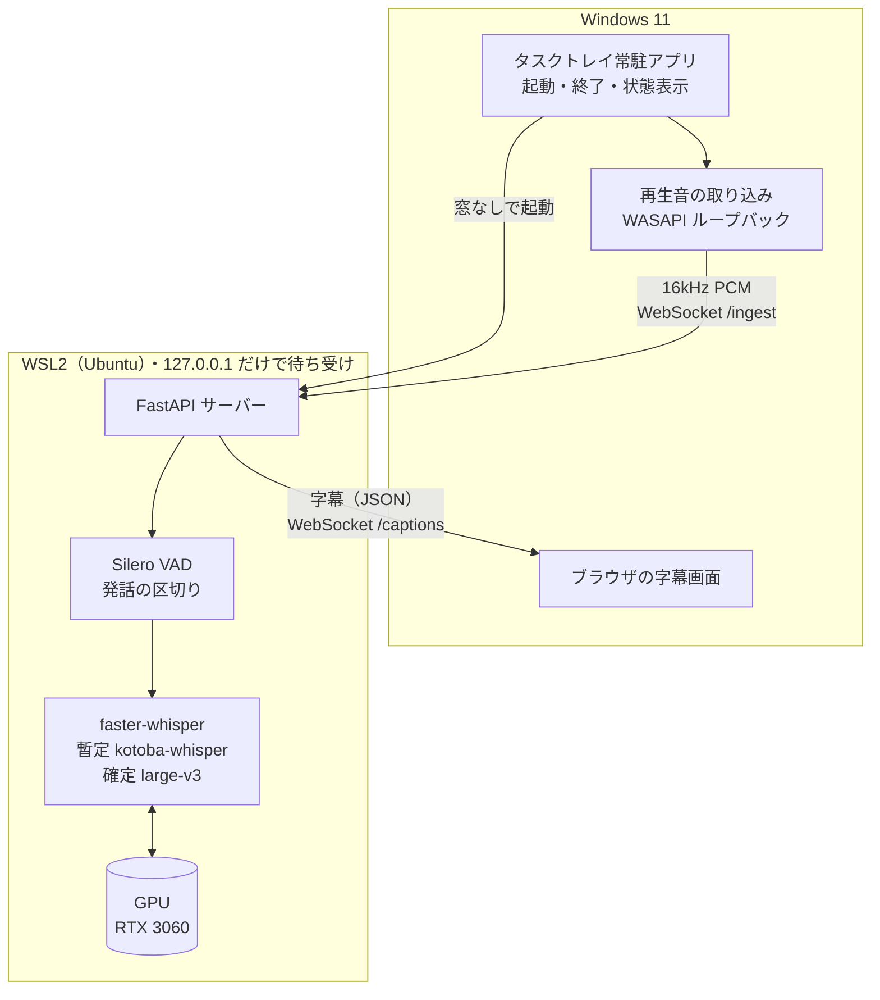
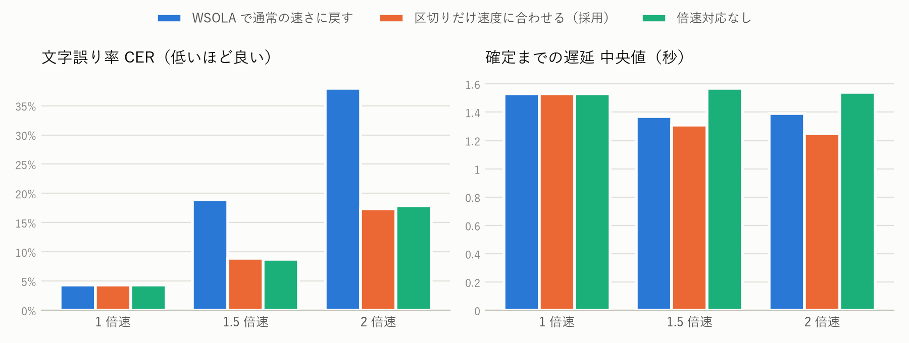

# リアルタイム字幕（realtime-transcriber）

PC で再生中の音声（ブラウザの動画・オンライン会議・説明会の配信など）を、**完全ローカル**で
リアルタイムに日本語の字幕にするアプリです。音声は PC の外に一切送らず、手元の GPU で認識します。



<sub>実際の速さ。音声は FLEURS（CC BY 4.0）の読み上げで、認識結果は手を加えていない（「胡氏」を「コ氏」と誤認識している）。</sub>

- デスクトップのアイコンをダブルクリックするだけで起動し、ブラウザに字幕が流れます
- 話している途中は灰色の暫定字幕を 1 秒ごとに出し、区切りがついたら高精度モデルで確定します
- 1.5 倍速・2 倍速で再生している動画も字幕にできます
- 社名や部署名などの固有名詞を用語集に登録できます。字幕は TXT / SRT で保存できます

## 構成



詳しい構成図（モデルの置き場所、1 つの発話が字幕になるまで、起動から終了までの流れ）は
[docs/architecture.md](docs/architecture.md) にあります。

## 設計判断

### 完全ローカルにした理由
説明会や会議の音声には、社外に出すべきでない内容が含まれることがあります。クラウドの音声認識 API を
使わず、認識はすべて手元の GPU で行います。サーバーは `127.0.0.1` だけで待ち受けるので、同じ Wi-Fi
の他の端末からも接続できません。インターネットを使うのはモデルの初回ダウンロードのときだけです。

### VAD による区切り
Whisper は 30 秒の窓で認識するモデルなので、ストリームを適切な長さに切る必要があります。
Silero VAD で発話区間を判定し、0.6 秒の無音で区切ります。話し続けて 20 秒に達したときは、
単語の途中で切らないよう、区間内で一番長い「間」を細かい設定の VAD で探して切ります。
区切った区間の先頭は切り詰めず、短い語頭が落ちる「抜け」を防いでいます。

### 暫定 / 確定の 2 段階
話し終わるまで何も出ないと、字幕として使いにくくなります。話している途中は軽いモデル・速い設定
（beam 1）で 1 秒ごとに暫定字幕を出し、区切りがついたら重いモデル・丁寧な設定（beam 5、温度フォールバック）
でやり直して確定します。待ち時間の短さと精度を両立するための分担です。

### 2 モデル構成
暫定には日本語に特化した軽量な kotoba-whisper v2.0、確定には Whisper large-v3 を使います
（設定画面で変更可能）。2 つを同時に載せても RTX 3060（12GB）に収まります（アプリ全体で約 7GB）。
確定まで kotoba だけで行う構成と比べると、遅延は 0.5 秒長くなりますが、CER は 7.0% → 4.3% に下がります
（[ベンチマーク](#ベンチマーク)）。

### 倍速対応 —— 測ってみたら仮説が外れたので設計を変えた
倍速の動画では無音も短くなるので、等速のままの 0.6 秒の判定では区切りが遅れます。そこで無音の判定時間を
再生速度で割ります。当初はさらに「倍速の音声は Whisper には聞き取りにくいはず」と考え、認識の直前に
WSOLA（ピッチを保ったまま速さを変える手法）で通常の速さに戻していました。

ベンチマークで方式ごとに切り分けると、**戻す処理は CER を倍以上に悪化させていました**（1.5 倍速で
8.9% → 18.9%、2 倍速で 17.4% → 38.0%）。倍速再生（速くする側）と戻す処理の歪みが重なるためと考えられます。
Whisper は倍速の音声をそのままでもかなり聞き取れました。そこで既定を「区切りだけ速度に合わせる」に変えました。
CER は対応しない場合と同等のまま、確定までの遅延が 0.25〜0.3 秒短くなります（`config.toml` の
`speed_restore = true` で従来の方式に戻せます）。

### 文脈と用語集
直前の確定文と用語集をプロンプト（`initial_prompt`）と `hotwords` として渡し、文のつながりと固有名詞の
表記を安定させます。架空の社名・部署名を含む評価セットでは、用語集で用語の正答率が 0% → 平均 31% に、
CER が 21.1% → 15.1% に改善しました。ただし効果は用語の並び順で 27〜36% と揺れ、1 回だけの測定では
過大に出ることがありました（初回の測定は 46%）。そのため並び順を変えた 5 回の平均で報告しています。

ただし蒸留モデルの kotoba-whisper にプロンプトを渡すと、文の途中で出力を止めてしまうことがベンチマークで
わかりました（1 文ずつ認識した CER が、渡さないと 7.8%、直前の文を渡すと 27.8%。100 文中 22 文が途中で止まる）。そのため kotoba などの
蒸留モデルにはプロンプトも `hotwords` も渡さず、確定用の large-v3 にだけ渡します。
直前の文をプロンプトに渡す効果は、互いに無関係な文が並ぶ FLEURS では確認できませんでした（4.07% → 4.32%）。
説明会のようにつながった話での効果は、このデータでは測れていません。

Whisper 特有の「同じ語の繰り返しの暴走」と、無音で出やすい定番の幻聴フレーズは除去します。

### ワンクリック起動
Windows で再生中の音は WSL から取得できないため、取り込みだけを Windows 側のプログラムに任せ、
重い処理は WSL 側の 1 つのサーバーにまとめています。2 つを別々に起動する手間をなくすため、
タスクトレイ常駐アプリがサーバーの起動（コンソール窓なし）・取り込み・字幕画面を開く・終了をまとめて行います。

## ベンチマーク

- 音声: FLEURS 日本語 test（CC BY 4.0）の 100 文を 1 秒の間でつないだ 約 24 分のストリーム（1 倍速）
- 環境: NVIDIA GeForce RTX 3060、2026-10-03 測定。`python -m bench.run` で再現できる
- CER は句読点・記号・空白を除き、NFKC で全角半角を揃えてから計算
- 遅延は「話し終わり（区間の終わり）から確定文が出るまで」。無音 0.6 秒の待ちを含む
- RTF は処理時間 ÷ 音声の長さ（1 未満なら実時間に追いつく）

### モデル構成（1 倍速）

| 構成 | CER | 遅延 p50 | 遅延 p90 | RTF |
|---|---:|---:|---:|---:|
| kotoba-whisper のみ | 7.0% | 1.01 秒 | 1.17 秒 | 0.24 |
| kotoba + large-v3（既定） | 4.3% | 1.53 秒 | 1.88 秒 | 0.29 |

### 倍速再生（kotoba + large-v3）

- WSOLA で戻す: 無音の判定時間を速度で割り、認識の前に WSOLA で通常の速さに戻す
- 区切りだけ: 無音の判定時間だけ速度で割り、倍速の音声のまま認識する
- なし: 倍速の音声を等速として区切り・認識する
- 倍速の音声は、ブラウザの倍速再生と同じくピッチを保ったまま速くしたもの（WSOLA）

| 再生速度 | 倍速対応 | CER | 遅延 p50 | 遅延 p90 | RTF |
|---:|---|---:|---:|---:|---:|
| 1 倍 | （等速） | 4.3% | 1.53 秒 | 1.88 秒 | 0.29 |
| 1.5 倍 | WSOLA で戻す | 18.9% | 1.37 秒 | 1.76 秒 | 0.32 |
| 1.5 倍 | 区切りだけ | 8.9% | 1.31 秒 | 1.73 秒 | 0.30 |
| 1.5 倍 | なし | 8.7% | 1.57 秒 | 1.94 秒 | 0.32 |
| 2 倍 | WSOLA で戻す | 38.0% | 1.39 秒 | 1.86 秒 | 0.36 |
| 2 倍 | 区切りだけ | 17.4% | 1.25 秒 | 1.57 秒 | 0.33 |
| 2 倍 | なし | 17.9% | 1.54 秒 | 2.00 秒 | 0.35 |

<picture>
  <source media="(prefers-color-scheme: dark)" srcset="bench/results/speed_dark.png">
  
</picture>

### 用語集（kotoba + large-v3、1 倍速）

架空の社名・部署名を含む自作の 12 文を Windows の音声合成（Haruka）で読み上げたもの（`bench/glossary/sentences.tsv`）。用語の正答率は、用語が正しい表記で出てきた割合。用語集の効果は用語の並び順で揺れるので、用語集ありは並び順を変えて 5 回測った平均（括弧内は最小〜最大）。

| 条件 | 用語の正答率 | CER |
|---|---:|---:|
| 用語集なし | 0.0% | 21.1% |
| 用語集あり | 30.9%（27.3%〜36.4%） | 15.1%（14.2%〜16.0%） |

評価ハーネスは `bench/` にあります。本物のモデル・VAD・区切りの処理を使い、サーバーの受信ループ
（0.1 秒ごとに音声が届き、認識中に届いた分はまとめて処理する）を仮想時計で再現しているので、
24 分の音声を実時間で流さなくても、実時間で流した場合と同じ遅延と RTF が得られます。

## セットアップ

### 必要なもの
- Windows 11 + WSL2（Ubuntu）
- NVIDIA の GPU（既定の 2 モデル構成でアプリ全体が約 7GB を使うので、VRAM 8GB 以上。開発は RTX 3060 12GB）と、
  WSL で CUDA が使えるドライバー
- [uv](https://docs.astral.sh/uv/)（WSL 側と Windows 側の両方）

### 1. WSL 側
```bash
git clone <このリポジトリ> ~/projects/realtime-transcriber
cd ~/projects/realtime-transcriber
uv sync   # Python 3.12 と依存（faster-whisper、cuBLAS / cuDNN など）を .venv に入れる
```
モデル（約 4.5GB）は初回の起動時に Hugging Face から自動でダウンロードします。

### 2. Windows 側
1. [uv をインストール](https://docs.astral.sh/uv/getting-started/installation/)する
2. エクスプローラーで `\\wsl.localhost\Ubuntu\home\<ユーザー名>\projects\realtime-transcriber\windows` を開き、
   `setup.bat` をダブルクリックする
3. デスクトップとスタートメニューに「リアルタイム字幕」ができる

### 使い方
1. 「リアルタイム字幕」をダブルクリックする。タスクバー右下の「^」の中にアイコンが出て、ブラウザに字幕画面が開く
2. 動画や会議の音声を再生すると字幕が流れる。画面右上の「⚙ 設定」で再生速度・用語集・モデルを変えられる
3. 終わるときはトレイのアイコンを右クリックして「終了」

コンソールで様子を見ながら動かしたいときは、`start.bat` でも起動できます。

## 既知の制約
- Windows + WSL2 + NVIDIA GPU が前提です（macOS / Linux デスクトップでの再生音の取り込みには未対応）
- 字幕画面はこの PC からのみ開けます（`127.0.0.1` だけで待ち受けるため。スマートフォンなどからは見られません）
- 取り込むのは「既定の再生デバイス」の音です。再生中に出力先（スピーカー / ヘッドホン）を切り替えた場合はアプリを起動し直してください
- 倍速再生では精度が下がります（CER は 1 倍速 4.3%、1.5 倍速 8.9%、2 倍速 17.4%）。正確さが必要なら 1.5 倍速までを推奨
- 話者の区別（話者分離）はしていません
- SRT の時刻は、音声を受け取り始めてからの経過時間です（倍速再生時は動画上の位置と一致しません）

## 開発

```bash
source .venv/bin/activate
python -m pytest            # GPU なしで動くテスト（偽の Transcriber・VAD・入力元を使う）
ruff check . && ruff format --check .

# ベンチマーク（GPU を使う。FLEURS の音声 約 450MB を bench/data/ にダウンロードする）
source scripts/gpu_env.sh
python -m bench.run && python -m bench.report
```

| ディレクトリ | 内容 |
|---|---|
| `src/realtime_transcriber/` | サーバー（FastAPI、VAD による区切り、faster-whisper、字幕画面） |
| `windows/` | タスクトレイ常駐アプリ、再生音の取り込み、セットアップ |
| `scripts/` | WSL 側のサーバーの起動・停止 |
| `bench/` | 評価ハーネス（CER・遅延・RTF） |
| `tests/` | pytest |
| `docs/` | 構成図 |

## クレジット
- 音声認識: [faster-whisper](https://github.com/SYSTRAN/faster-whisper)（MIT）、
  [kotoba-whisper v2.0](https://huggingface.co/kotoba-tech/kotoba-whisper-v2.0-faster)（Apache-2.0）、
  [Whisper large-v3](https://huggingface.co/Systran/faster-whisper-large-v3)（MIT）、Silero VAD（MIT）
- ベンチマークの音声: [FLEURS](https://huggingface.co/datasets/google/fleurs)（Google、CC BY 4.0）の日本語 test セット。
  音声はリポジトリに含めず、評価時にダウンロードします
