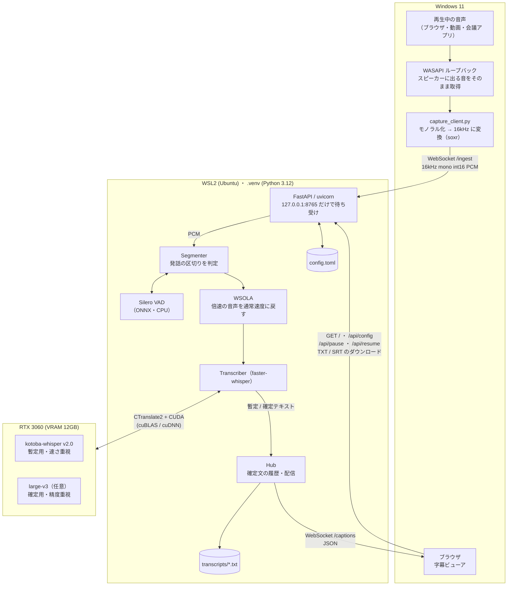
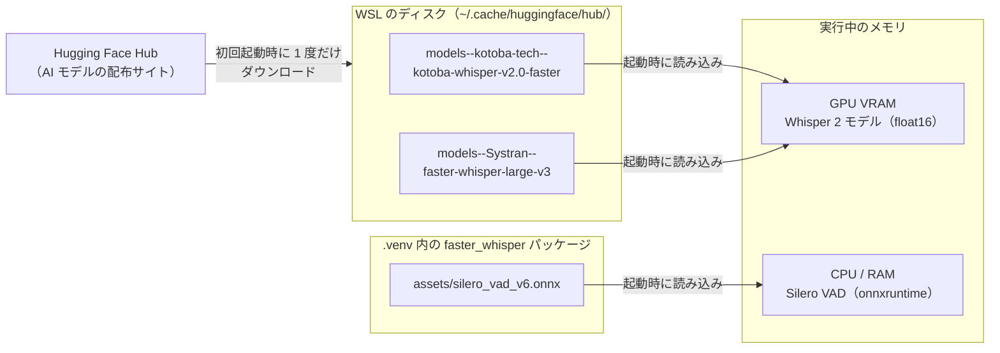
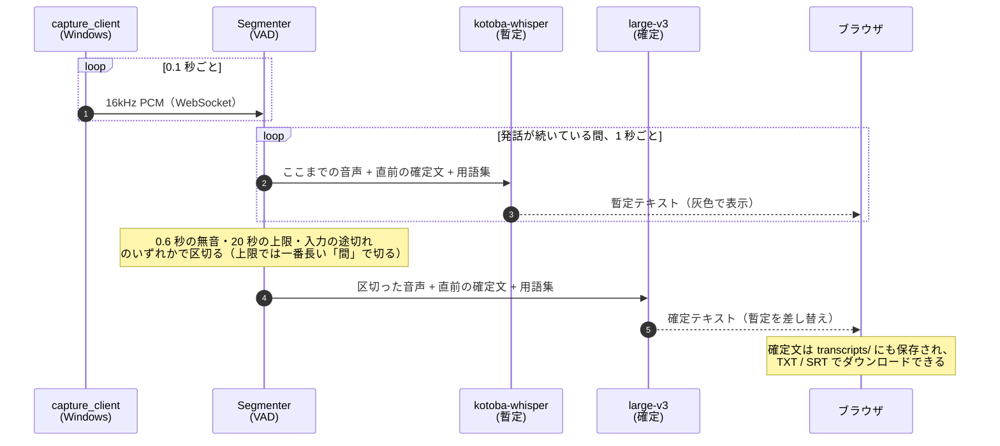

# アーキテクチャ

> Phase 1（Web UI 化）完了時点の構成。実装が変わったらこの図も更新する。

PC で再生中の音声を、外部に一切送らずにローカルの GPU でリアルタイムに文字起こしする。
処理は Windows 側（音声の取り込み）と WSL2 側（文字起こし・Web UI）に分かれ、
両者は PC の中だけで閉じた WebSocket（`127.0.0.1:8765`）でつながっている。

## 全体構成

- **音声は PC の外に出ない。** サーバーは `127.0.0.1` だけで待ち受け、Windows の `localhost` からは WSL2 の localhost 転送で届く。同じ Wi-Fi の他の端末からも接続できない。
- **Windows 側で取り込む理由:** WSL からは Windows で再生中の音を取得できないため、取り込みだけを Windows のプログラムに任せている。
- **重い処理は WSL 側にまとめる:** GPU を使う処理、区切りの判定、Web UI の配信は 1 つのサーバープロセスが担当する。
- **設定は `config.toml` とブラウザから:** モデル・再生速度・用語集はブラウザの設定画面から変えられ、`config.toml` に保存される。起動時の CLI 引数はそれより優先される。
- **一時停止:** ブラウザで一時停止すると、受け取った音声を捨てるだけでなく、区切り待ちの途中の音声も破棄する（再開後に停止前の音声が字幕に混ざらない）。

## AI モデルはどこにあるか

| モデル | 役割 | 配布元 | 保存場所 | 動く場所 |
|---|---|---|---|---|
| kotoba-whisper v2.0（CTranslate2 形式） | 暫定表示用。日本語に特化し、軽くて速い | Hugging Face `kotoba-tech/kotoba-whisper-v2.0-faster` | `~/.cache/huggingface/hub/` | GPU |
| Whisper large-v3（CTranslate2 形式） | 確定用。精度重視（任意。`final_model` が空なら kotoba-whisper で確定も行う） | Hugging Face `Systran/faster-whisper-large-v3` | `~/.cache/huggingface/hub/` | GPU |
| Silero VAD v6（ONNX） | 発話か無音かの判定 | `faster-whisper` パッケージに同梱 | `.venv/.../faster_whisper/assets/` | CPU |

- インターネットを使うのは、**モデルの初回ダウンロードのときだけ**。文字起こしの処理中は通信しない（`HF_HUB_OFFLINE=1` を付けて起動してもそのまま動く）。
- CTranslate2 形式は、Whisper の重みを推論向けに変換した形式。`faster-whisper` がこれを読み込み、CTranslate2 が CUDA（cuBLAS / cuDNN）を通じて GPU で計算する。
- cuBLAS / cuDNN はシステムにインストールせず、pip の `nvidia-cublas-cu12` / `nvidia-cudnn-cu12` を `.venv` に入れて使っている（`source .venv/bin/activate` でライブラリのパスが通る）。

## 1 つの発話が字幕になるまで

- **暫定と確定の 2 段階:** 暫定は軽いモデルと速い設定（beam 1）ですぐに表示し、確定は重いモデルと丁寧な設定（beam 5）でやり直す。待ち時間の短さと精度を両立するための分担。
- **倍速再生への対応:** 指定した再生速度に合わせて無音判定の時間を縮め、認識の直前に WSOLA で通常速度に戻す（ピッチは変えない）。
- **文脈と用語集:** 直前の確定文と用語集をプロンプトとして渡し、固有名詞の表記ゆれを減らす。Whisper 特有の繰り返しの暴走と、定番の幻聴フレーズは取り除く。
